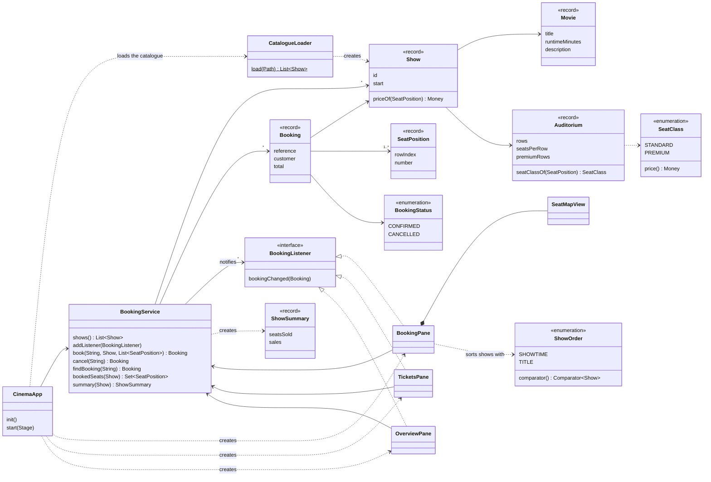
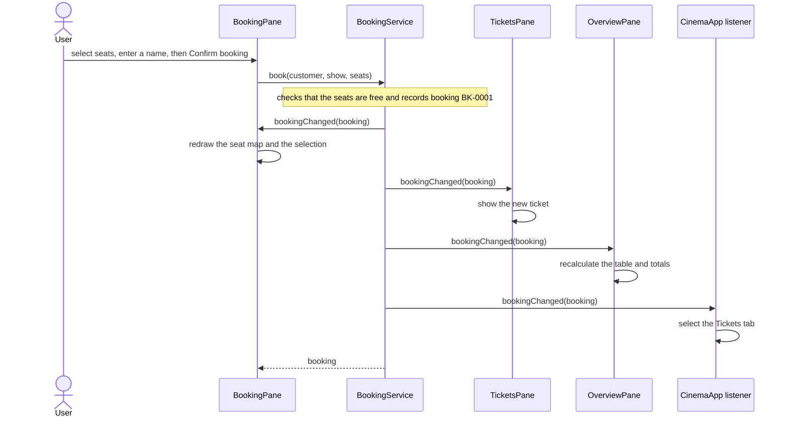

# Design

The Cinema Ticket Booking System is a Java desktop application made of 19 Java source files in one folder, `src`, in the default package. This page describes its object-oriented design: the classes and their relationships, how a booking flows through them, and the Observer and Strategy patterns. The [README](../README.md) explains how to build and run it.

## Classes

| Class | Kind | Responsibility |
|---|---|---|
| `CinemaApp` | class, extends `Application` | Loads the catalogue, builds the window with its three tabs, and registers the tabs as booking listeners. |
| `CatalogueLoader` | class | Reads the catalogue file and creates the movies, auditoriums and shows. |
| `CatalogueException` | class, extends `Exception` | An invalid catalogue line; the message names the line. |
| `Movie` | record | A film: id, title, running time in minutes and a short description. |
| `Auditorium` | record | A screen with rows of seats. It tells whether a seat is standard or premium; the rear rows are premium. |
| `Show` | record | One screening: a movie in an auditorium at a start time. It prices seats. |
| `SeatClass` | enum | `STANDARD` (₹250) and `PREMIUM` (₹350), each holding its price. |
| `SeatPosition` | record | A seat such as `C7`. It is `Comparable`, ordered by row and then by number. |
| `Money` | record | An exact amount in paise, printed like `₹600.00`. |
| `Booking` | record | A booking: reference, customer name, show, seats, total and status. |
| `BookingStatus` | enum | `CONFIRMED` or `CANCELLED`. |
| `ShowSummary` | record | Seats sold and sales of one show, with its occupancy, such as `2 of 96 (2.1%)`. |
| `BookingService` | class | Holds the shows and bookings. It books and cancels, finds bookings by reference, works out the booked seats and summaries, and notifies its listeners. |
| `BookingListener` | interface | Receives every new or cancelled booking. |
| `BookingPane` | class, extends `BorderPane` | The Booking tab: the show list with its sort selector, the show details, the seat map, and the selection with its total and the customer's name. |
| `SeatMapView` | class, extends `VBox` | The seat map: one toggle button per seat, and the user's selection of up to 10 seats. |
| `TicketsPane` | class, extends `BorderPane` | The Tickets tab: the latest ticket, lookup by reference and cancellation. |
| `OverviewPane` | class, extends `BorderPane` | The Overview tab: seats sold, occupancy and sales per show and in total. |
| `ShowOrder` | enum | The two show orderings, each a `Comparator<Show>`. |

`BookingService` is the only class that changes bookings. The panes display its data and send it the user's requests. A seat counts as booked while a confirmed booking lists it, so cancelling a booking frees its seats.

## Class diagram

The arrows between `Show`, `Movie` and `Auditorium` are plain associations, because several shows share one movie or auditorium. `BookingPane` owns its `SeatMapView`: it creates it and never shares it. `CinemaApp` also registers a fourth listener, a lambda that opens the Tickets tab after a confirmed booking.

## Booking a ticket

Cancelling works the same way: `TicketsPane` calls `cancel(reference)`, and every listener is told about the cancelled booking. The Tickets tab marks the ticket as cancelled, the Booking tab frees the seats, and the Overview recalculates its figures.

## Design patterns

### Observer

- **Subject:** `BookingService` keeps a list of `BookingListener`s, added with `addListener`.
- **Observer interface:** `BookingListener` has one method, `bookingChanged(Booking)`.
- **Observers:** `BookingPane`, `TicketsPane`, `OverviewPane`, and the lambda in `CinemaApp` that switches to the Tickets tab.
- **Trigger:** after every successful booking or cancellation, `BookingService` calls each listener with the new or cancelled booking. It does so after its synchronized update.

Each view decides for itself how to react, and adding another view only means registering one more listener.

### Strategy

- **Strategy interface:** Java's `Comparator<Show>`.
- **Strategies:** the `ShowOrder` enum supplies one comparator for each option: `SHOWTIME` compares start times, and `TITLE` compares movie titles alphabetically.
- **Context:** `BookingPane` lists the `ShowOrder` options in a selector next to the show list. Showtime is the default. When the user picks an option, the pane sorts its list with that option's comparator.

The algorithm is chosen at runtime, and another ordering would be one more enum constant. This is Java's own `Comparator` used as a Strategy.

## Object-oriented decisions

- **Encapsulation.** `BookingService` keeps its bookings, reference counter and listeners private; the rest of the program can change bookings only through `book` and `cancel`. `SeatMapView` keeps the seat selection private and hands out a copy through `selection()`.
- **Composition and association.** A `Show` refers to a shared `Movie` and `Auditorium`, and a `Booking` refers to its `Show` and its seats. `BookingPane` is composed with its `SeatMapView`.
- **Inheritance.** `CinemaApp` extends `Application` and overrides `init` and `start`. The panes extend `BorderPane`, `SeatMapView` extends `VBox`, the show list's cells extend `ListCell` and override `updateItem`, and `CatalogueException` extends `Exception`.
- **Interfaces and polymorphism.** `BookingService` calls `bookingChanged` on every listener without knowing their classes. `ShowOrder` provides `Comparator<Show>` objects, and `SeatPosition` implements `Comparable`, so bookings and selections list their seats in order.
- **Records and enums.** `Movie`, `Auditorium`, `Show`, `SeatPosition`, `Money`, `Booking` and `ShowSummary` are record-based value models whose fields cannot be reassigned. Enums carry data and behaviour: each `SeatClass` holds its price, and each `ShowOrder` holds its label and comparator.
- **Collections.** The service keeps the bookings in a `LinkedHashMap` by reference, in booking order, and works out booked seats as a `Set`. The seat map keeps the selection in a `TreeSet`, so it stays in seat order. The loader looks up movies and auditoriums by id in maps.
- **Files and exceptions.** `CatalogueLoader` reads the catalogue with `Files.readAllLines`. A basic format error raises a checked `CatalogueException`, and an unreadable file raises an `IOException`; `CinemaApp` shows either message in the window instead of the tabs. Booking a seat that is already booked raises an `IllegalStateException`.
